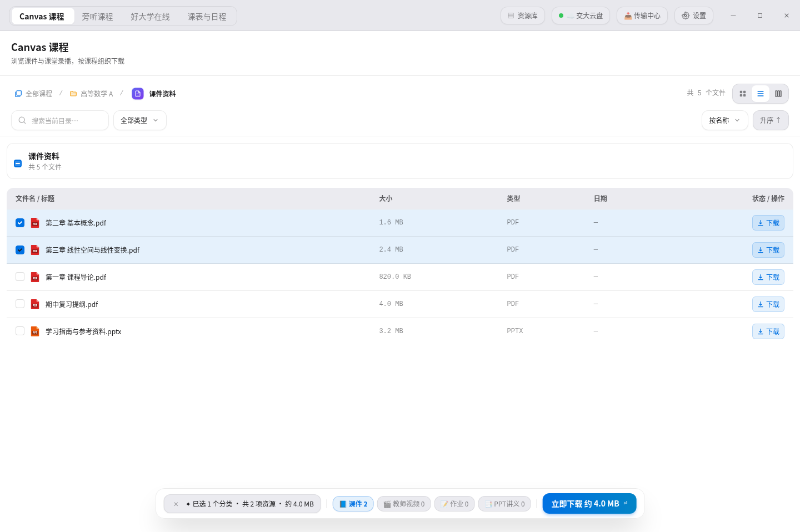

# SJTU 课程下载器

面向交大师生的课程资源下载与整理工具。桌面端支持 Canvas 课件与录播、已获授权的旁听课程、好大学在线、交大云盘和课表日程；安卓端专注课程文件、日程、提醒与桌面小组件。

[介绍网站](https://sjtu.hisunalan.me) · [桌面端图文指南](docs/desktop.md) · [安卓介绍](docs/android.md) · [反馈问题](https://github.com/sunalan2025/sjtu-downloader-all-in-one/issues)

截图由桌面应用的实际 React 组件渲染，使用示例账号与资料，不包含真实学生信息。更多界面见[图文指南](docs/desktop.md)。

## 下载与安装

桌面端和安卓端独立发布。安装包和校验和均位于本仓库的 GitHub Releases。

| 平台 | 当前正式版 | 安装包 |
| --- | --- | --- |
| Windows x64 | [2.5.3](https://github.com/sunalan2025/sjtu-downloader-all-in-one/releases/tag/v2.5.3) | `.exe` 或 `.msi` |
| macOS Apple Silicon | [2.5.3](https://github.com/sunalan2025/sjtu-downloader-all-in-one/releases/tag/v2.5.3) | arm64 `.dmg` 或 `.zip` |
| Linux x86_64 | [2.5.3](https://github.com/sunalan2025/sjtu-downloader-all-in-one/releases/tag/v2.5.3) | `.AppImage` |
| Android | [1.0.0](https://github.com/sunalan2025/sjtu-downloader-all-in-one/releases/tag/android-v1.0.0) | [下载 APK](https://github.com/sunalan2025/sjtu-downloader-all-in-one/releases/download/android-v1.0.0/SJTU-Downloader-Android-v1.0.0.apk) |

macOS 当前提供的 DMG 和 ZIP 都是 Apple Silicon（arm64），ZIP 不是 Intel 安装包。Linux AppImage 需要赋予执行权限。桌面端未购买商业代码签名，安装前请确认来源并按需核对 `SHA256SUMS.txt`。安卓沿用历史公开签名以兼容同签名旧版，详见[安卓说明](docs/android.md)。

部分课件、录播和教务数据需要校园网、交大 VPN 或对应账号授权。应用不能代替学校授权，也不提供绕过访问限制的能力。

## 桌面端能做什么

| 入口 | 用途 |
| --- | --- |
| Canvas 课程 | 按学期浏览课程、目录和资源，搜索、分类、多选下载；支持课件、课堂录播、作业及部分导出功能 |
| 旁听课程 | 浏览已获旁听授权的课程与讲次，按教师/PPT 视角选择内容 |
| 好大学在线 | 按课程、章节和资源类型选择已授权内容 |
| 课表与日程 | 查看课程、考试、活动与作业截止；学校提供时显示提交、批改和评分；导出 `.ics` |
| 交大云盘 | 浏览、搜索、上传、下载与整理文件，提供列表、图标和分栏视图 |
| 传输中心 | 查看进度、速度、失败信息和下载历史，按任务类型暂停、继续或取消 |
| 资源库 | 查看课程归档、订阅更新与可恢复任务 |
| 设置 | 管理保存位置、传输方式、媒体偏好、外观、账号与退出行为 |

不同行为的支持范围有区别：课程通用传输队列与云盘文件上传并非同一套队列，不能统一保证所有任务都有暂停、续传或跨重启恢复。详见[云盘说明](docs/cloud-drive.md)和[资源库说明](docs/backup-library.md)。

## 从三个常见任务开始

- **只下载这周需要的课件**：选择学期 → 进入课程 → 打开“课件资料”及子目录 → 勾选需要的文件 → 确认保存位置与模式 → 开始下载。[图文步骤](docs/desktop.md#示例一下载部分课程资料)
- **把资料整理到云盘**：从“交大云盘”浏览目录，或在课程下载时选择云盘/双份保存。默认仍需客户端传输；校内远端节点需要自行配置。[图文步骤](docs/desktop.md#示例二整理和备份到交大云盘)
- **查本周课表和作业状态**：打开“课表与日程”，查看周视图和作业截止区；需要时导出到系统日历。[图文步骤](docs/desktop.md#示例三查看课表考试和作业)

## 安卓应用

安卓端提供课程文件下载、课程/考试/作业/个人日程、分类提醒、独立后台同步及两款桌面日程组件，适配手机和平板。桌面端的完整旁听、好大学在线和云盘管理目前不包含在安卓端。

[安卓介绍与截图](docs/android.md) · [安卓源码与构建](mobile/README.md)

## 文档与开发

- [桌面端图文指南](docs/desktop.md)：实际界面、常见任务与安装问题。
- [交大云盘](docs/cloud-drive.md)：操作、冲突处理及能力边界。
- [资源库和任务恢复](docs/backup-library.md)：归档、订阅及恢复范围。
- [开发与发布](docs/development.md)：本地构建、检查、截图更新和网站发布。
- [技术架构](docs/architecture.md)与[前端结构](docs/frontend-architecture.md)：源码组织与实现说明。
- [安全说明](SECURITY.md) · [MIT 许可](LICENSE)。

本项目是独立开源工具，非上海交通大学官方应用。请在授权范围内使用教学资源。
