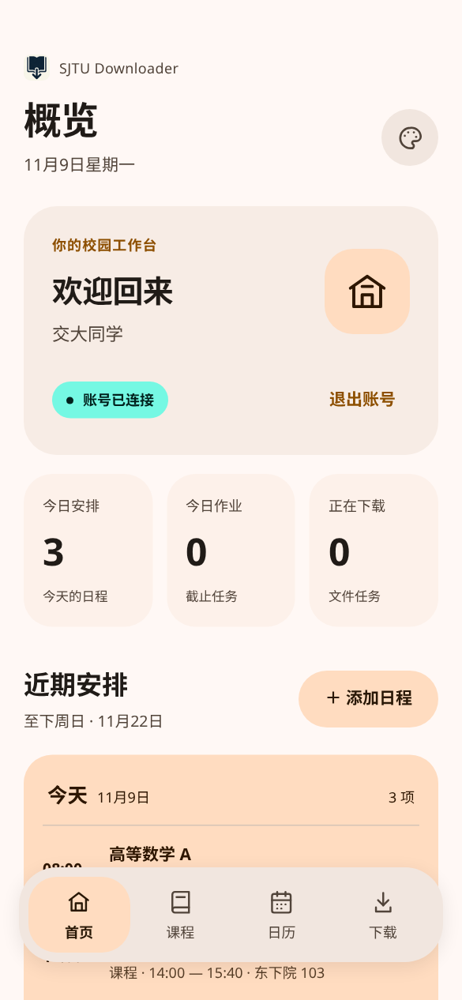
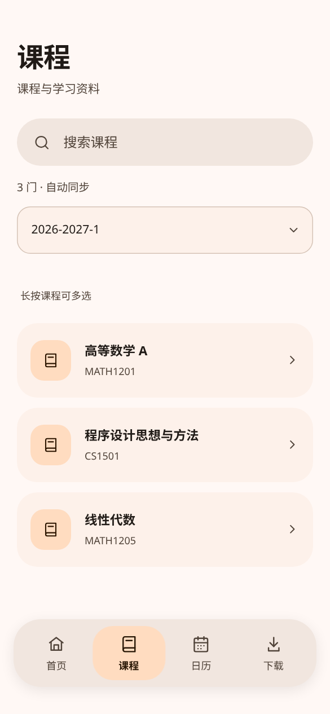
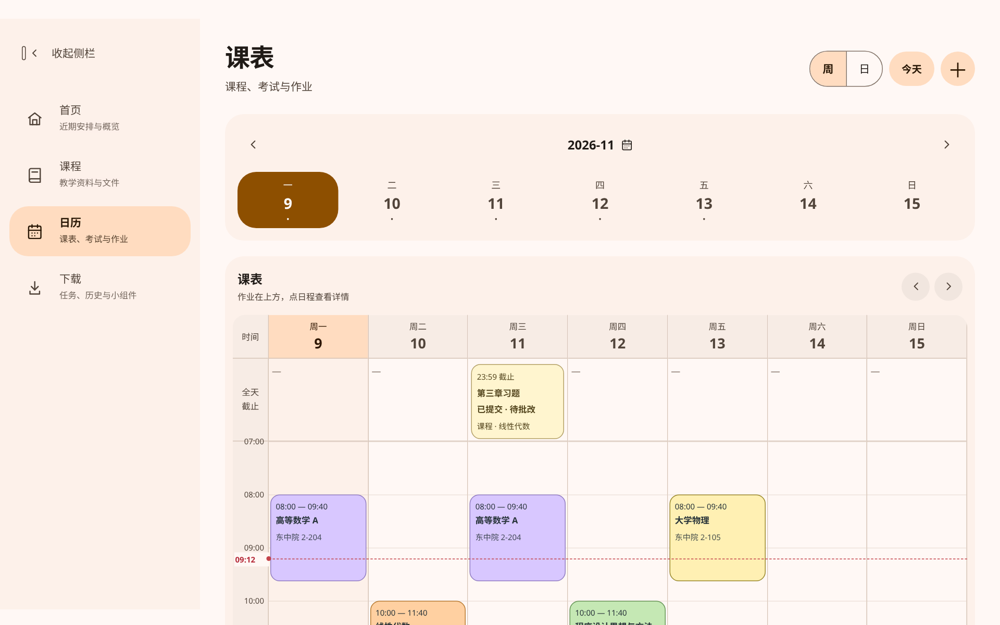

# 安卓应用

SJTU Downloader for Android 将课程资源与校园日程放在手机和平板上，提供 Material You 明暗主题、系统取色和随屏幕调整的导航。

[下载 Android 1.0.0 APK](https://github.com/sunalan2025/sjtu-downloader-all-in-one/releases/download/android-v1.0.0/SJTU-Downloader-Android-v1.0.0.apk) · [正式版说明](https://github.com/sunalan2025/sjtu-downloader-all-in-one/releases/tag/android-v1.0.0)

## 主要功能

- **课程与下载**：登录交大账号，按学期浏览和搜索课程，查看文件、批量下载、管理任务与历史。
- **近期安排**：课程、考试、作业和个人日程依次加载，首页最多显示至下周日。
- **日历**：周课表和每日列表，课程以不同浅色区分，考试名称附“考试”，支持真实起止时间和实时时间虚线。
- **作业状态**：学校提供相关信息时显示是否提交、是否批改和评分。
- **桌面日程**：每日安排与周课表两款组件，过去日程变灰。周六、周日保留本周末并预览下周工作日，表头分两行显示日期范围。
- **提醒与同步**：课程、个人日程、考试、作业分别设置提前时间，提供免打扰与锁屏隐私设置。后台定期同步单独开启。
- **手机与平板**：手机底部页签、大屏侧栏，统一按钮、设置子页面及可中断的展开、收起和页面过渡。

## 界面预览

截图来自实际应用页面，使用示例账号与日程，不包含真实学生信息。

| 首页 | 课程资源 |
| :---: | :---: |
|  |  |

## 安装与首次使用

1. 下载 APK，按手机提示允许当前浏览器或文件管理器安装应用。
2. 打开应用并登录交大账号。课程、考试和文件取决于学校授权，校外部分资源需要校园网或交大 VPN。
3. 在“下载 → 偏好设置 → 系统权限”按需允许通知、准时更新及后台电量访问，再进入“通知与后台同步”开启所需功能。
4. 在桌面长按空白处，从小组件列表添加每日安排或周课表，也可从应用内请求添加。不同桌面的入口名称可能不同。

通知未授权时无法开启日程提醒；授权本身不会自动启用提醒。后台同步和通知分别设置，系统省电可能推迟后台更新。系统强行停止应用后，需要重新打开才能恢复任务。

最低 Android 6.0，Android 12 及以上提供系统动态取色与原生清晰文字周组件。仅支持可安装 APK 的安卓兼容系统，纯 HarmonyOS NEXT 不支持。

## 更新与源码

Android 与桌面端使用独立安装包与版本号。Android 1.0.0 可覆盖同签名旧版，保留登录、个人日程及偏好设置；不要先卸载旧版，以免清除本地数据。

现有直装版本沿用历史公开的固定签名，以保持升级兼容；它不属于私密生产签名。请从本仓库正式 Release 获取 APK，并核对同一发布的 `SHA256SUMS.txt`。

[安卓源码与构建](../mobile/README.md) · [设计参考与许可](../mobile/docs/DESIGN_REFERENCES.md)
