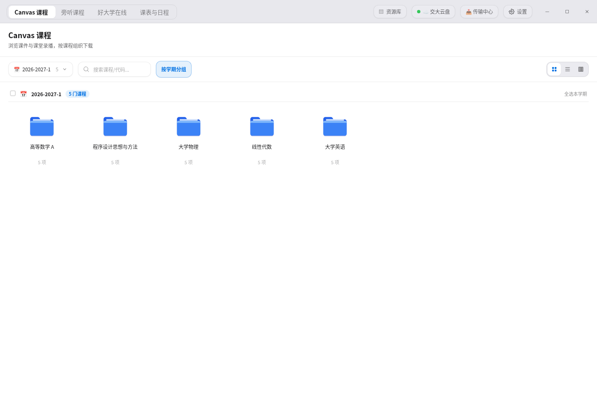
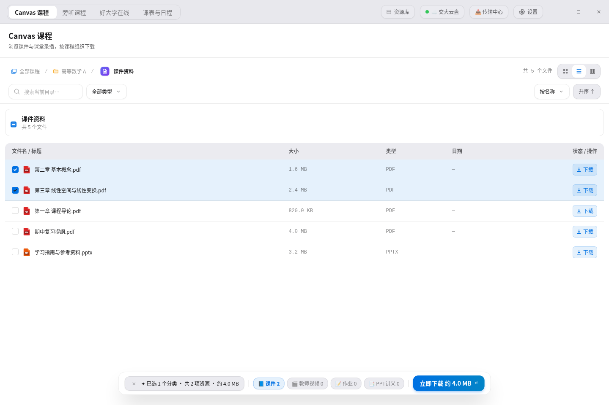
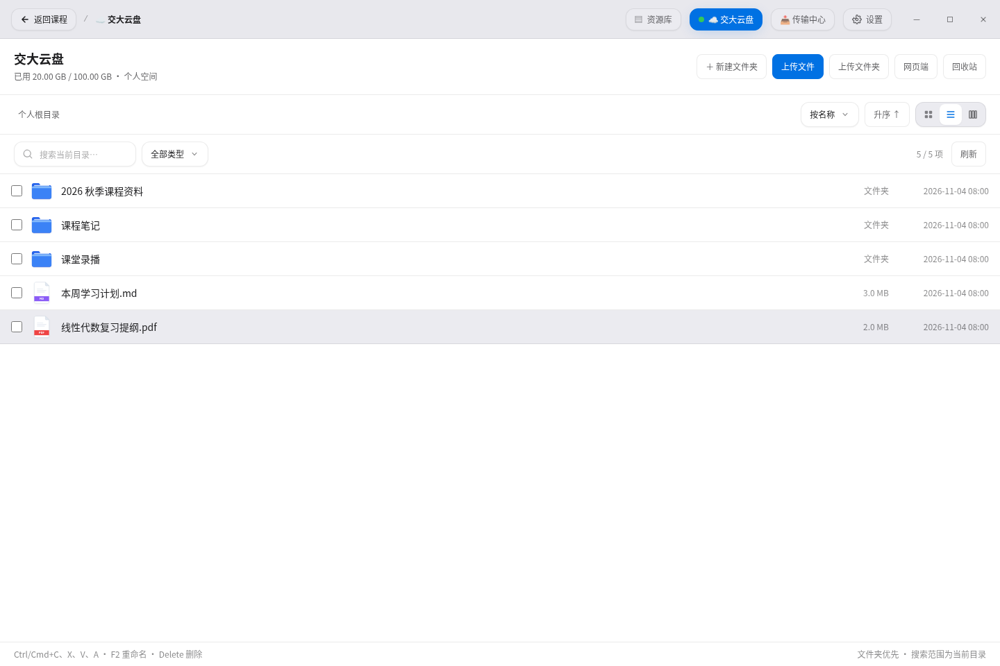
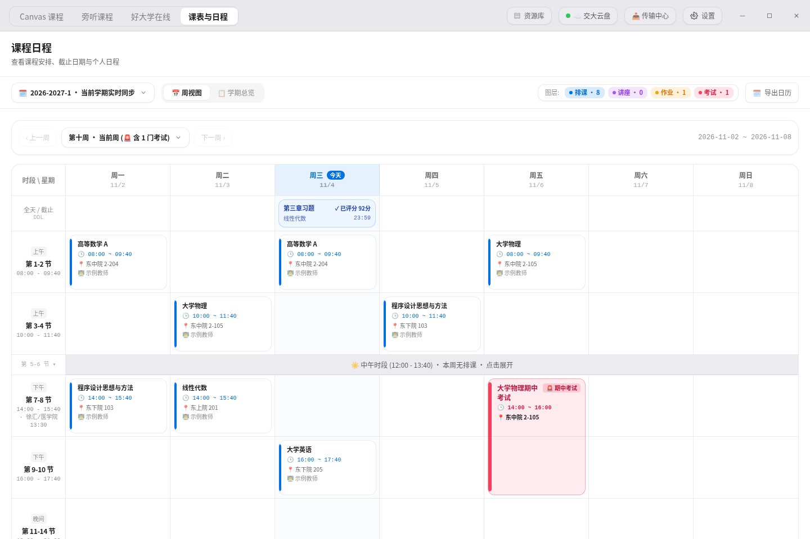
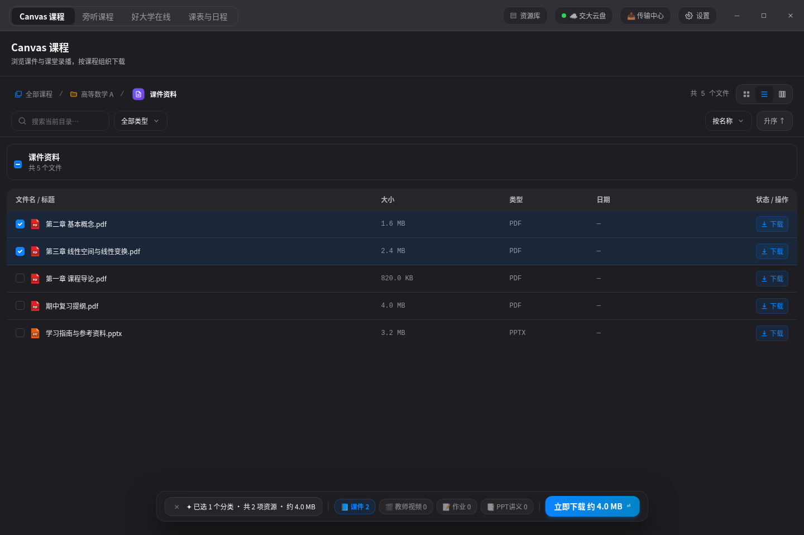

# 桌面端图文指南

适用于当前桌面正式版 2.5.3。界面截图由应用实际 React 组件渲染，使用示例课程、账号、文件及日程；它们展示界面与操作入口，不代表对真实学校账号进行下载测试。

[下载桌面版](https://github.com/sunalan2025/sjtu-downloader-all-in-one/releases/tag/v2.5.3) · [介绍网站](https://sjtu.hisunalan.me) · [返回 README](../README.md)

## 先认识界面

顶部左侧切换 Canvas 课程、旁听课程、好大学在线和课表与日程；右侧进入资源库、交大云盘、传输中心和设置。

Canvas 支持学期筛选、按学期分组，以及网格、列表和分栏视图。课程内继续按课件资料、课程作业与提交、课堂视频等分类查看。

## 示例一：下载部分课程资料

**例子：只保存高等数学中需要的两份 PDF。**

1. 完成 jAccount 登录；需要校园网络的内容，请先连接校园网或交大 VPN。
2. 打开“Canvas 课程”，选择对应学期，进入“高等数学 A”。
3. 打开“课件资料”，继续进入所需子文件夹。可切到列表查看名称、大小和类型，用搜索或文件类型缩小范围。
4. 勾选需要的文件。也可以选择分类或文件夹，让应用收集该范围内可下载的资源。
5. 确认保存位置和模式。可选本地保存、云盘保存或双份保存，再从下载操作区开始任务。
6. 在“传输中心”查看结果；如果失败，先根据提示检查授权、网络和目录权限，不要把“已加入队列”当作“已完成”。

课堂录播可根据来源选择教师/PPT 视角；PPT/PDF、字幕、作业导出等入口只在对应来源提供内容时可用。旁听课程与好大学在线使用各自页面，不会自动获得未授权资源。

## 示例二：整理和备份到交大云盘

**例子：把本学期资料放进云盘的课程文件夹。**

1. 打开右上方“交大云盘”，等待账号连接完成。学校会话过期时，先按提示重新登录。
2. 浏览或搜索目标目录。支持图标、列表、分栏视图，文件夹优先显示。
3. 按需新建目录、上传本地文件/文件夹，或选择已有内容进行复制、移动、重命名和删除。
4. 下载云盘内容时，先确认本地目录。操作完成后查看任务状态，同名冲突需要按提示处理。
5. 也可以在课程下载操作中选择云盘或双份保存。默认传输仍经过客户端；希望由校内节点代传时，需要自行配置网络设置中的远端节点。

云盘本地文件上传目前不能统一套用课程下载的暂停、断点续传和跨重启恢复能力。分享、协作权限和版本历史等仍由官方网页端提供。完整范围见[云盘说明](cloud-drive.md)。

## 示例三：查看课表、考试和作业

**例子：检查本周考试，并确认作业是否已经评分。**

1. 打开“课表与日程”，选择当前学期或需要查看的学期。
2. 在周视图切换周次，通过图层控制课程、活动、作业和考试的显示。
3. 作业截止集中在上方区域；学校提供相关信息时，显示已提交、待批改或分数。状态缺失并不等于未提交。
4. 点击日程查看详细时间和地点。考试安排来自学校提供的数据，以学校最新通知为准。
5. 需要导入系统日历时，选择“导出日历”，勾选内容并设置提醒时间，生成 `.ics` 文件。

## 外观与日常管理

在“设置”中选择浅色、深色或跟随系统；调整保存目录、传输并发、媒体偏好以及关闭窗口时的行为。

已下载的归档、课程订阅和可恢复任务从“资源库”进入。恢复范围取决于来源、任务类型和保存的检查点，详见[资源库说明](backup-library.md)。

## 安装和常见问题

- **Windows**：提供 x64 EXE 和 MSI。应用未购买商业代码签名，出现 SmartScreen 提示时先核对下载来源与校验和，再按系统提示操作。
- **macOS**：当前 DMG 和 ZIP 均为 Apple Silicon（arm64），ZIP 不是 Intel 版本。请先确认电脑芯片。
- **Linux**：当前提供 x86_64 AppImage，先赋予执行权限；凭据加密能力取决于系统密钥环是否可用。
- **校外资源不可用**：检查校园网/VPN、学校授权和登录状态。应用无法替代这些条件。
- **保存位置**：在首次使用向导或“设置 → 存储与下载”确认，不要假定所有机器都使用相同目录。
- **重复文件与恢复**：跳过、覆盖和续传是不同操作。已有文件检查、部分下载和恢复都受来源及任务类型限制，以任务反馈为准。

[开发、截图生成与网站发布说明](development.md)
