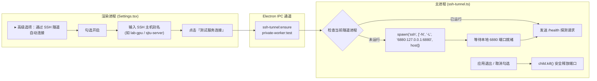

# 内置 SSH 隧道自动托管（私有中转高级选项）实施计划

> **Goal**: 在交大课程下载器中内置通用的 OpenSSH 隧道原生托管引擎。在「设置 → ⚡ 传输与网络 → 校内私有中转服务」卡片中提供折叠的「高级选项：通过 SSH 隧道自动连接」，让拥有实验室服务器、寝室 NAS 或私有云主机的师生能够零手动敲命令、一键自动穿透校内防火墙，享受免本地流量的内网极速代传。

---

## 架构与安全设计

### 安全与开源合规准则
1. **0 隐私硬编码**：全代码库仅包含标准通用的调度逻辑，占位符为通用的 `lab-gpu` 或 `my-server`，用户的实际主机名与端口仅保存在本地的客户端存储中；
2. **防命令注入保护**：主机名仅允许合法的主机名字符（字母、数字、点、减号、下划线），严格禁止 shell 管道符与分号；
3. **孤儿进程防护**：主进程使用 `before-quit`、`exit`、`SIGINT` 多重钩子监听，确保主应用退出或崩溃时绝对杀死后置 SSH 子进程，避免端口死锁。

---

## 实施任务拆解

- [ ] **Task 1: 数据类型与接口协议定义 (`src/shared/types.ts`)**
  - 定义 `PrivateWorkerTunnelConfig` 接口（`enabled`, `host`, `remotePort`, `localPort`）；
  - 在 `PrivateWorkerConfig` 中扩展可选字段 `tunnel?: PrivateWorkerTunnelConfig`；
  - 定义 `SshTunnelStatus` 接口（`running`, `pid`, `host`, `localPort`, `error`）；
  - 在 `WindowApi` 中暴露 `startSshTunnel`, `stopSshTunnel`, `getSshTunnelStatus`。

- [ ] **Task 2: 主进程 SSH 隧道跨平台管理器与参数守护 (`src/main/ssh-tunnel.ts`, `src/main/index.ts`, `src/preload/index.ts`)**
  - 创建 `src/main/ssh-tunnel.ts`：
    - `startSshTunnel(config)`：参数合法性校验、安全拉起 `ssh -N -L` 子进程、端口探针就绪等待；
    - `stopSshTunnel()`：温和 SIGTERM + 超时 SIGKILL；
    - `getSshTunnelStatus()`：返回当前活跃状态；
    - 绑定应用退出自动清理钩子；
  - 在 `src/main/index.ts` 注册 IPC 处理器；
  - 在 `src/preload/index.ts` 暴露预加载 API。

- [ ] **Task 3: 设置界面高级折叠卡片与交互集成 (`src/renderer/src/pages/Settings.tsx`, `src/renderer/src/store/app.ts`)**
  - 在 `app.ts` 的持久化 state 中接入 `tunnel` 默认值与状态管理；
  - 在 `Settings.tsx` 的私有中转服务模块中实现「▸ 高级选项：通过 SSH 隧道自动连接」折叠面板；
  - 支持主机别名输入、端口配置、状态胶囊（未连接 / 🟢 隧道就绪 / 错误提示）；
  - 测试服务连接时如果配置了隧道，自动静默联动建桥。

- [ ] **Task 4: 专属单元测试编写 (`test/unit/ssh-tunnel.test.ts`)**
  - 测试参数安全校验（合法主机名通过、非法注入拦截）；
  - 测试生命周期管理与 Mock 进程模拟；
  - 测试 `testPrivateWorker` 在配置隧道时的联动能力。

- [ ] **Task 5: 全链路门禁终验与整分支审查 (Final Whole-Branch Review)**
  - 运行 `npm run typecheck`（0 错误）；
  - 运行 `npm run lint`（0 警告）；
  - 运行 `npm test`（全套测试 100% 绿灯）。
