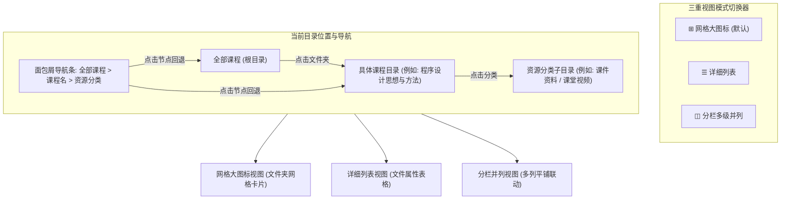

# 网盘式资源管理器架构、三重视图系统与窗口退出策略设计规范

- **日期**：2026-10-11
- **状态**：待评审 (Draft)
- **范围**：UI 架构、课程浏览器下钻导航、夸克网盘风格三重视图、窗口退出与下载保护、登录状态纠偏

---

## 1. 目标与设计背景

### 1.1 核心问题诊断
1. **课程列表无序展开，视觉层次紊乱**：
   - 现行实现启动后自动将所有课程与其内部的所有课件、视频条目无脑全量展开，数十门课程连绵成极长的信息流，导致卡片高矮极度不一、横向网格错落、难以快速定位。
2. **缺乏网盘级文件夹层级交互体验**：
   - 用户期望参考**夸克网盘**的组织形式，将课程资源抽象为真实的文件夹层级，初始收起，支持下钻打开，并提供夸克网盘标配的三重视图切换：
     - **分栏多级并列视图 (Column View / Miller Columns)**：左中右多栏逐级展开，快速扫视；
     - **详细列表视图 (List View)**：下钻式面包屑导航 + 标准文件列表表格；
     - **网格大图标视图 (Grid View)**：下钻式面包屑导航 + 大文件夹图标网格阵列。
3. **状态文本样式误导**：
   - 顶部操作栏的 `☑ 已选 398 项 (3.54 GB)` 为只读信息展示，但因绘制了与可点击按钮完全相同的外框和阴影，被用户误认为可点击按钮。
4. **登录后误跳设置页面**：
   - 状态持久化将 `activeTab: 'settings'` 写入本地存储，冷启动或认证完成后直接读取历史残留状态，错误将用户带入设置页。
5. **系统退出与下载保护机制缺失**：
   - 缺少关闭主窗口是“最小化到系统托盘”、“最小化到任务栏”还是“彻底退出”的配置项；
   - 缺少有正在下载任务时是“弹窗确认”、“自动后台继续”还是“自动暂停并退出”的精细化策略。

---

## 2. 系统架构与交互设计

### 2.1 网盘式下钻与三重视图架构 (Netdisk Resource Explorer)



#### A. 视图模式规范 (View Modes)
1. **网格大图标视图 (`grid` - 默认首选项)**：
   - **根目录**：整齐展示当前学期的所有课程大文件夹卡片（蓝色现代文件夹大图标、课程全称、学期徽标、内部资源总数/总大小统计、快速勾选框）。
   - **单击/双击进入**：点击文件夹卡片下钻进入该课程，面包屑更新为 `全部课程 / [课程名]`。
   - **课程内**：展示该课程下的分类大文件夹（`📁 课件资料`、`🎬 课堂视频`、`📑 PPT课件(PDF)`）。再次点击即可进入查看具体文件大图标。
2. **详细列表视图 (`list`)**：
   - **表格列定义**：`[复选框] 文件名/课程名` | `大小` | `类型 (文件夹/PDF/PPT/MP4)` | `学期/日期` | `快速操作 (下载/展开)`。
   - **交互**：点击文件夹行下钻进入，点击文件行勾选/播放/打开。
3. **分栏多级并列视图 (`column`)**：
   - 采用 macOS Finder / 夸克网盘标配的 Miller Columns 分栏设计：
     - **第 1 栏**：当前学期的全部课程列表（带右箭头 `›` 指示符）；
     - **第 2 栏**：选中课程的二级资源分类列表（`课件资料`、`课堂实录`、`PPT课件`）；
     - **第 3 栏**：选中分类的具体文件流（文件名、格式徽标、大小、状态与下载按钮）。
   - 用户只需在左右栏间横向移动视觉，层级一目了然，无需频繁进出下钻。

#### B. 面包屑导航栏 (Breadcrumb Bar)
- 置顶渲染在工具栏下方或整合在操作栏左侧：
  - `📚 全部课程` ➔ `📂 程序设计思想与方法 (C)` ➔ `📄 课件资料`
- 每个层级均可点击瞬间回退；最右侧提供层级统计（如 `共 6 个文件 · 预估 28.5 MB`）。

#### C. 跨层级多选与下载状态同步
- **整课全选**：在课程文件夹外层勾选复选框，自动递归标记该课程下全部课件与视频；
- **分类全选**：在分类层级勾选，仅标记该分类内部资源；
- **已选统计解耦**：右上角 `☑ 已选 X 项 (Y GB)` 彻底剥离按钮外框与阴影，作为纯净的状态信息展示；旁边的 `已选全部` 与 `立即下载` 保留实体按钮外框与主色调。

---

## 3. 窗口退出与下载保护策略设计

### 3.1 状态模型扩展 ([store/app.ts](file:///d:/SJTU/编程/sjtu-downloader-all-in-one/src/renderer/src/store/app.ts))
```ts
export type WindowCloseAction = 'tray' | 'taskbar' | 'quit'
export type ExitWhenDownloadingPolicy = 'prompt' | 'background' | 'pause_quit'
export type CourseViewMode = 'grid' | 'list' | 'column'

interface AppState {
  // 窗口与退出偏好
  windowCloseAction: WindowCloseAction              // 默认 'tray' (最小化到托盘)
  exitWhenDownloading: ExitWhenDownloadingPolicy    // 默认 'prompt' (弹窗询问防误触)
  courseViewMode: CourseViewMode                    // 默认 'grid' (网格大图标)
  
  setWindowCloseAction: (action: WindowCloseAction) => void
  setExitWhenDownloading: (policy: ExitWhenDownloadingPolicy) => void
  setCourseViewMode: (mode: CourseViewMode) => void
}
```

### 3.2 登录状态与持久化纠偏
- **脱敏持久化**：
  ```ts
  partialize: state => ({
    ...
    // 若当前为设置页或传输页，只持久化回退课程 Tab，启动绝不默认进入设置
    activeTab: (state.activeTab === 'settings' || state.activeTab === 'transfer')
      ? (state.lastCourseTab || 'canvas')
      : state.activeTab,
    windowCloseAction: state.windowCloseAction,
    exitWhenDownloading: state.exitWhenDownloading,
    courseViewMode: state.courseViewMode
  })
  ```
- **登录回调回正**：登录成功时强制将 `activeTab` 重置为选定的课程源，彻底解决启动跳设置的 Bug。

### 3.3 设置面板布局 ([Settings.tsx](file:///d:/SJTU/编程/sjtu-downloader-all-in-one/src/renderer/src/pages/Settings.tsx))
在「🎨 外观与通用」中增设专属的「窗口关闭与退出行为」卡片分区：
1. **关闭主窗口动作**：
   - 三态 Segmented 单选：`[ 最小化到系统托盘 (推荐) | 最小化到任务栏 | 彻底退出应用 ]`
   - 辅助文字：“点击窗口右上角 × 或按 Alt+F4 时的响应动作。选择最小化到托盘可后台无感驻留。”
2. **下载进行中退出策略**：
   - 三态 Segmented 单选：`[ 始终弹窗询问确认 (推荐) | 自动转入托盘继续下载 | 自动暂停任务并退出应用 ]`
   - 辅助文字：“当有未完成的课件或视频传输时触发关闭的应对机制，有效防误触中断传输。”

---

## 4. 实施计划与影响文件清单

| 文件路径 | 变更职能 |
|---|---|
| `src/renderer/src/store/app.ts` | 增加 `windowCloseAction`、`exitWhenDownloading`、`courseViewMode`，加固 `activeTab` 持久化脱敏过滤 |
| `src/renderer/src/components/DownloadUI.tsx` | 重构操作栏组件：去除只读状态外框、升级三态视图切换器 `[ ◫ 分栏 | ☰ 列表 | ⊞ 网格 ]` |
| `src/renderer/src/components/BreadcrumbBar.tsx` | 新增网盘式面包屑下钻导航组件 |
| `src/renderer/src/components/NetdiskExplorer.tsx` | 新增网盘式多视图控制器，统一驱动 Canvas、旁听课与好大学在线的下钻与展示 |
| `src/renderer/src/pages/CanvasBrowser.tsx` | 移除全量无脑平铺展开的旧代码，接入网盘式浏览器与面包屑导航 |
| `src/renderer/src/pages/AuditedCourses.tsx` | 接入网盘式浏览器与三重视图 |
| `src/renderer/src/pages/CnmoocBrowser.tsx` | 接入网盘式浏览器与三重视图 |
| `src/renderer/src/pages/Settings.tsx` | 渲染窗口关闭与下载保护设置项 |
| `src/renderer/src/components/WindowConfirmModal.tsx` | 联动读取用户配置的退出策略（`prompt` / `background` / `pause_quit`） |
| `src/main/window.ts` | 支持标准任务栏最小化与托盘后台协同 IPC |

---

## 5. 测试与验证标准

1. **类型与构建验证**：
   - `npm run typecheck` 零错误；
   - `node scripts/run-electron-vite.mjs build` 零警告无构建报错。
2. **自动化测试套件回归**：
   - 全部 17 个测试套件，422+ 项测试用例全部持续保持 PASS。
3. **用户体验回归**：
   - 登录后稳定展示课程首屏，不再跳转设置页；
   - 默认课程不再倾泻式展开几十个文件，呈清爽整齐的文件夹网格；
   - 点击可下钻进入，面包屑可返回，可在分栏、列表、网格间自由无缝切换；
   - `已选 X 项` 为纯文本状态呈现，彻底消除非点击按钮的误导感；
   - 窗口关闭与有任务退出严格遵循用户在设置中设定的行为。
