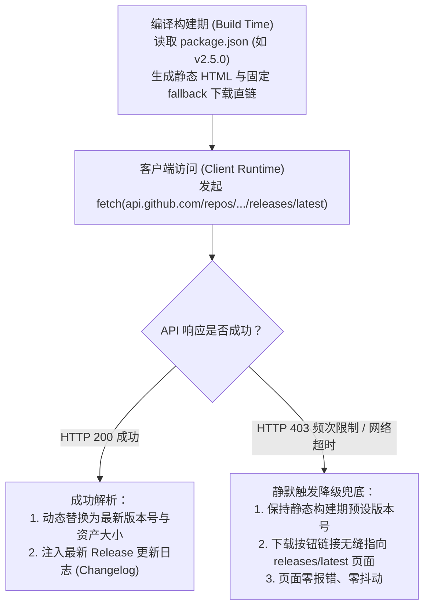

# 上海交通大学课程下载器 官方介绍网站 (Showcase Website) 技术与交互设计方案

> **文档状态**：已评审并批准 (Approved)  
> **创建日期**：2026-10-23  
> **适用模块**：官网独立工程 (`website/`)、自动部署工作流 (`.github/workflows/website-deploy.yml`)、域名与 DNS 解析 (`sjtu.hisunalan.me`)

---

## 1. 背景与建设目标

### 1.1 背景与现状
上海交通大学课程下载器（`sjtu-course-downloader`）作为专为交大师生打造的一站式课程资源批量下载与知识归档工具，已全面支持 Canvas 课件录播、旁听课程视频自动时序归整、好大学在线（CNMOOC）以及交大云盘（pan.sjtu.edu.cn）双向备份。

目前项目主要依托 GitHub 仓库 README 向用户介绍功能与提供安装包下载，缺乏独立、现代、高视觉冲击力且兼顾各平台系统自动识别下载的品牌官网。同时，作者拥有个人主域名 `hisunalan.me`，希望在保留 GitHub 开源生态和免费全球 CDN 优势的同时，建立专属二级域名官网 `sjtu.hisunalan.me`，并在 GitHub 个人主页与项目主页形成品牌闭环。

### 1.2 建设目标
1. **现代产品落地官网 (Modern Product Landing Page)**：建立集视觉质感、核心特性动效、系统级安全背书、交互式 FAQ 与安装包矩阵于一体的官方门户；
2. **智能操作系统探测下载 (Smart OS Detection)**：访问者进入网站后，前端自动识别操作系统（Windows、macOS Apple Silicon / Intel、Linux），主按钮直达对应最优安装包，并支持版本动态拉取与离线兜底；
3. **独立工程与零依赖污染**：网站代码作为独立工程存放在主仓库 `/website` 目录下，采用 Astro + Tailwind CSS 技术栈，零 JS 运行时负担，首屏秒开，完全不污染主工程 Electron 客户端；
4. **自动化 CI/CD 与自定义域名双轨联动**：基于 GitHub Actions 自动化构建部署至 GitHub Pages，无缝绑定 `sjtu.hisunalan.me` 并自动签发 HTTPS 证书。

---

## 2. 词汇规范化对照表 (UI Copywriting Alignment)

遵循高校师生实际使用场景，所有官网对外展示文本严格对齐规范化词汇：

| 内部技术表述 / 原始待定文案 | 拟规范化官网展示表述 | 修改考量与用户体验收益 |
| :--- | :--- | :--- |
| 分块切片提取 / 抽帧抓取 | **PPT 课件导出为单份 PDF 讲义** | 突出核心学习收益，消除“切片/抽帧”等生硬技术名词 |
| 拉取旁听课程 / 爬取列表 | **同步已选旁听课程** | 符合高校教务系统日常用语，严谨专业 |
| 静默下载 / 后台挂起 | **后台自动续传下载** | 消除歧义，清晰表达“即使关闭主窗口，任务仍在后台安全进行” |
| 双向云同步 | **本地与交大云盘双备份** | 准确反映工具不仅能存本地，还能将课件免网页端备份到个人交大云盘 |
| 覆盖 / 冲突策略 | **智能跳过已有同名文件** | 突出“省流量、省带宽、避免重复下载”的用户价值 |

---

## 3. 架构设计与工程组织

### 3.1 目录组织结构 (`/website`)

```text
sjtu-downloader-all-in-one/
├── .github/
│   └── workflows/
│       ├── ci.yml                 # 原有客户端 CI 门禁
│       ├── release.yml            # 原有客户端发布流水线
│       └── website-deploy.yml     # 🚀 新增：官网自动构建与 GitHub Pages 部署流水线
├── website/                       # 🌐 官网独立子工程
│   ├── public/
│   │   ├── CNAME                  # 存放自定义域名: sjtu.hisunalan.me
│   │   ├── favicon.svg            # 网站专属交大蓝矢量图标
│   │   ├── og-image.png           # 社交分享与微信卡片预览图
│   │   └── screenshots/           # 客户端界面高精度演示图
│   ├── src/
│   │   ├── components/            # Astro / 前端交互组件
│   │   │   ├── Navbar.astro       # 顶栏导航与主题切换
│   │   │   ├── Hero.astro         # 首屏焦点与 Slogan
│   │   │   ├── SmartDownload.astro# 智能操作系统探测下载器（含客户端 JS 岛屿）
│   │   │   ├── FeatureMatrix.astro# 四大支柱功能矩阵
│   │   │   ├── SecuritySpec.astro # 硬件保险库与安全架构背书
│   │   │   ├── DownloadTable.astro# 全平台各格式下载矩阵与环境准入提示
│   │   │   ├── FaqSection.astro   # 常见问题交互式手风琴
│   │   │   └── Footer.astro       # 页脚开源生态与版权信息
│   │   ├── layouts/
│   │   │   └── Layout.astro       # 基础 HTML 骨架、SEO 元标签与 OpenGraph
│   │   ├── pages/
│   │   │   └── index.astro        # 官网落地页核心入口
│   │   ├── styles/
│   │   │   └── global.css         # 基础样式与色彩变量
│   │   └── utils/
│   │       ├── osDetector.ts      # 访问者操作系统与芯片架构识别
│   │       └── releaseInfo.ts     # GitHub API 动态版本与静态构建兜底逻辑
│   ├── astro.config.mjs           # Astro 静态站点生成配置 (site: https://sjtu.hisunalan.me)
│   ├── tailwind.config.mjs        # 官网定制主题系统（交大蓝、微光特效、字体栈）
│   ├── package.json               # 官网独立依赖 (astro, tailwindcss, lucide-astro 等)
│   └── tsconfig.json              # 官网独立 TypeScript 严格配置
```

### 3.2 技术栈与核心依赖
- **核心框架**：Astro 5.x（Static Site Generation, 默认 0 运行时 JS，极高首屏性能）
- **样式方案**：Tailwind CSS 3.4+（原子化样式、深浅色无缝自适应、毛玻璃效果）
- **图标系统**：Lucide 图标集
- **构建输出**：纯静态 HTML/CSS/JS 资源目录 (`website/dist/`)

---

## 4. 页面核心内容与交互组件设计

### 4.1 视觉系统规范 (Visual Tokens)
- **品牌主色调**：
  - 交大经典深蓝（SJTU Heritage Navy）：`#004098`
  - 现代科技电光蓝（Modern Electric Blue）：`#165DFF`（操作按钮、高光、徽标高亮）
  - 极光青（Aurora Cyan）：`#00D2D3` / `#38BDF8`（背景微光、渐变强调）
- **深浅色双模设计**：
  - **深色模式（Dark）**：深空夜蓝渐变背景（`#070B14` 至 `#0D1527`）搭配细点阵网格与柔和电光蓝微光，突出高端极客质感；
  - **浅色模式（Light）**：象牙白微冷底色（`#F8FAFC`），搭配交大蓝半透明磨砂卡片与细腻投影，学术感与现代感兼备；
  - 顶栏常驻「跟随系统 / 浅色 / 深色」切换开关，支持 LocalStorage 本地持久化。

### 4.2 核心模块与功能流转

#### 1. 顶栏导航 (`Navbar.astro`)
- 左侧：SJTU Downloader 专属 Logo，标明“上海交通大学课程下载器”；
- 中间：锚点快速跳转（核心特性 · 安全背书 · 下载中心 · 常见问题）；
- 右侧：GitHub Repo 动态 Star 计数徽章 + 深浅色切换按钮 + 快速下载外链。

#### 2. Hero 聚焦区 (`Hero.astro` & `SmartDownload.astro`)
- 主标题：**专为上海交通大学师生打造的课程资源与知识归档工具**；
- 副标题：一站式聚合 Canvas 课件、旁听课程视频、好大学在线与交大云盘备份，多线程极速传输；
- **智能操作系统探测下载器**：
  - 前端提取 `navigator.userAgent` 智能判定操作系统及硬件架构：
    - Windows: 匹配 `sjtu-course-downloader-*-win-x64.exe`；
    - macOS Apple Silicon: 匹配 `*-mac-arm64.dmg`；
    - macOS Intel: 匹配 `*-mac-x64.dmg`；
    - Linux: 匹配 `*-linux-x86_64.AppImage`；
  - 主操作按钮显示“立即下载对应安装包 (v2.5.0)”；
  - 次级入口“查看所有平台与格式”平滑展开完整下载矩阵。
- **客户端界面展示框 (App Showcase Frame)**：
  - 模拟 macOS 原生交通灯标题栏与玻璃质感外壳；
  - 悬浮呈现客户端现代化网格卡片与分栏视图超清截图，带有微妙的呼吸光晕与视差立体感。

#### 3. 四大支柱功能矩阵 (`FeatureMatrix.astro`)
采用 2x2 响应式响应卡片，呈现四大核心能力：
1. 📚 **Canvas 教学全量提取**：原始课件树状层级保留；大纲与模块补漏附件智能整理；课堂录播提供“教师视角”与“PPT 视角”双路超清流；支持将课堂切片自动合成导出为单份高清 PDF 讲义。
2. 🎬 **旁听课程视频规整**：一键同步已选旁听课程；纠偏教务系统课次乱序问题，按开课真实日期轴归整重排；支持单选或整门课程批量高速下载。
3. 🎓 **好大学在线 (CNMOOC)**：章节单元层级树状下钻；智能过滤无下载实体的随堂测验，杜绝空白项。
4. ☁️ **交大云盘深度集成**：免网页登录直连单点登录（SSO）；支持“仅本地”、“仅上传云盘”与“本地/云盘双备份”三种存储模式；文件重命名、新建文件夹与云端回收站全功能管理。

#### 4. 系统级安全与工程原理 (`SecuritySpec.astro`)
1. **原生硬件保险库**：采用操作系统级硬件安全保险库（Windows DPAPI / macOS Keychain）加密存储用户凭据，磁盘绝无明文数据。
2. **表单绝不自动提交**：自动填充机制仅向输入框回填账号密码，坚决不自动触发表单提交，保障用户充裕确认时间与二次验证安全性。
3. **动态并发与流控调度**：支持 1~16 档任务并发调节、动态带宽限速、断点续传与同名文件智能跳过。

#### 5. 下载矩阵与环境准入指引 (`DownloadTable.astro`)
- 完整展示 Windows (`.exe` / `.msi`)、macOS (`.dmg` / `.zip`)、Linux (`.AppImage`) 下载直链与适用说明；
- **环境准入核心提示**：
  - 必须连接 **SJTU 校园网无线 (SJTU/SJTU-Premium)** 或开通 **交大 VPN (EasyConnect)**；
  - Windows SmartScreen 提示应对方案：点击「更多信息」→「仍要运行」；
  - 安装包已内置各平台专用 FFmpeg 二进制，免去手动安装任何外部依赖。

#### 6. 交互式常见问题 FAQ (`FaqSection.astro`)
采用平滑折叠手风琴（Accordion）设计，解答师生高频问题：
- Q1: 为什么部分课程视频无法播放或提示下载失败？（校园网与 VPN 检测指引）
- Q2: 下载的文件保存在本地哪里？（默认目录与可自定义归档层级说明）
- Q3: 关闭主窗口后下载会中断吗？（后台系统托盘常驻保活与防意外中断机制）
- Q4: 多账号如何切换与安全清理？（凭据保险库管理与别名切换说明）

#### 7. 页脚与开源社区生态 (`Footer.astro`)
- 项目开源许可证（MIT License）；
- GitHub 仓库 Star、Fork 与 Issues 快速入口；
- 个人主页与技术博客外链；
- 免责声明：本项目为个人课余开源开发，仅供上海交通大学在校师生学习交流与教学研究使用。

---

## 5. 数据联动与双轨兜底保障 (Data Flow & Fallback)



---

## 6. 自动化部署与域名接入方案 (Deployment & Domain Runbook)

### 6.1 GitHub Actions 工作流配置 (`.github/workflows/website-deploy.yml`)

```yaml
name: Deploy Showcase Website to GitHub Pages

on:
  push:
    branches: [ master ]
    paths:
      - 'website/**'
      - '.github/workflows/website-deploy.yml'
  release:
    types: [ published ]
  workflow_dispatch:

permissions:
  contents: read
  pages: write
  id-token: write

concurrency:
  group: 'pages'
  cancel-in-progress: true

jobs:
  build-and-deploy:
    environment:
      name: github-pages
      url: ${{ steps.deployment.outputs.page_url }}
    runs-on: ubuntu-latest
    steps:
      - name: Checkout Repository
        uses: actions/checkout@v4

      - name: Setup Node.js
        uses: actions/setup-node@v4
        with:
          node-version: 22
          cache: 'npm'
          cache-dependency-path: 'website/package-lock.json'

      - name: Install Website Dependencies
        working-directory: website
        run: npm ci

      - name: Build Static Website
        working-directory: website
        run: npm run build

      - name: Setup Pages
        uses: actions/configure-pages@v5

      - name: Upload Pages Artifact
        uses: actions/upload-pages-artifact@v3
        with:
          path: 'website/dist'

      - name: Deploy to GitHub Pages
        id: deployment
        uses: actions/deploy-pages@v4
```

### 6.2 域名与 DNS 上线极简操作步骤
1. **DNS 记录添加**（在用户域名解析后台 `hisunalan.me`）：
   - 主机记录：`sjtu`
   - 记录类型：`CNAME`
   - 记录值：`sunalan2025.github.io`
2. **GitHub 仓库开启 Pages**：
   - 进入 GitHub 仓库 `Settings` → `Pages`；
   - **Source** 选择 `GitHub Actions`；
   - 由于工程构建产物中已包含 `website/public/CNAME`（内容为 `sjtu.hisunalan.me`），GitHub Pages 将自动绑定该域名，并在证书下发后自动开启 `Enforce HTTPS`。
3. **个人主页导流徽章**：
   - 在个人主页或 GitHub Profile 中添加访问徽章：
     `[](https://sjtu.hisunalan.me)`

---

## 7. 质量门禁与全链路验证策略 (Verification Gate)

1. **官网子工程独立门禁**：
   - 静态类型检查：`cd website && npm run check`（0 错误）；
   - 静态构建检查：`cd website && npm run build`（0 错误 0 警告，产物正确输出到 `dist` 目录）。
2. **主项目回归验证**：
   - 根目录下执行 `npm run typecheck`（TypeScript 静态检查 0 错误）；
   - 根目录下执行 `npm run lint`（ESLint 检查 0 错误 0 警告）；
   - 根目录下执行 `npm test`（自动化单元测试 100% 通过）。
